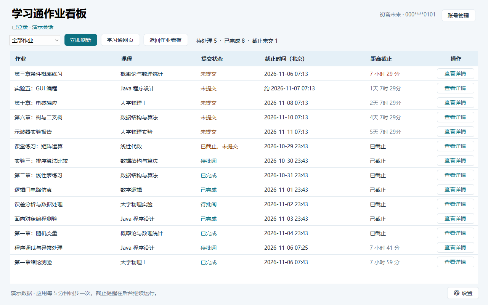
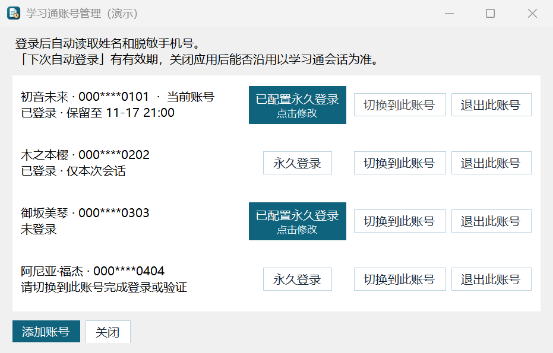
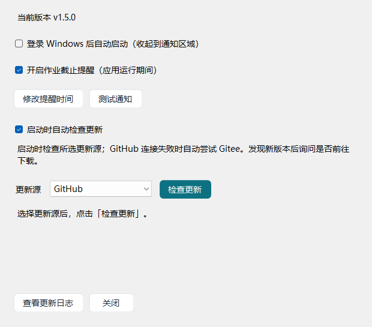

# chaoxingTasksPanel

**English** | [简体中文](README.zh-CN.md)

A Windows desktop dashboard for Chaoxing (Xuexitong) assignments. See what is due across your courses, check submission status, and open assignment details or download attachments from the dashboard.

`Windows x64` · `C# / .NET 10` · `WinForms / WebView2` · `v1.5.0`

## Screenshots

These previews use the offline version with fictional assignments and accounts. The application UI is in Simplified Chinese.

### Assignment dashboard



### Account management



### Settings



## Features

| Feature                          | Description                                                                                                                                                                                                                                  |
| -------------------------------- | -------------------------------------------------------------------------------------------------------------------------------------------------------------------------------------------------------------------------------------------- |
| Assignment dashboard             | See each assignment, its course, submission status, deadline in Beijing time, and time remaining.                                                                                                                                            |
| Filtering and sorting            | Filter pending or completed assignments. Click the status, deadline, or time-remaining header to toggle sorting. Overdue, unsubmitted assignments have a distinct status. Click the assignment header to restore the default order.          |
| Automatic refresh                | The dashboard synchronizes every five minutes. Select Refresh Now to sync on demand.                                                                                                                                                         |
| Assignment details and downloads | Open each assignment in its own window and switch via Alt+Tab or taskbar previews. Choose where to save attachments. Details and attachment preview windows are 100 pixels wider in v1.5.0.                                                  |
| Multiple accounts                | Add, switch, or sign out of accounts independently. Account management shows each account's name and masked phone number when available.                                                                                                     |
| Sign-in status                   | Check the current session at startup and display whether it is signed in, temporary, or has a known expiration. Optional persistent sign-in can attempt to sign in again when a session expires.                                             |
| Deadline reminders               | Receive Windows notifications before deadlines and once at expiry. Customize reminder times in Settings, or select Test Notification to test immediately. Reminder history prevents duplicate notifications after restarting.                |
| System tray                      | Closing or minimizing the main window keeps synchronization and reminders running. Double-click the tray icon to reopen it; use the tray menu to confirm exit. Optional Windows startup launches the app in the notification area.           |
| Updates and changelog            | View and copy the bundled changelog. Automatic update checks are enabled by default and can be disabled. Choose GitHub or Gitee; GitHub failures automatically fall back to Gitee. Available updates open a release page after confirmation. |
| Installation and upgrades        | A modern Chinese MSI wizard supports custom installation paths, direct upgrades, repair, and uninstall. Upgrades reuse the saved path and preserve user data. The portable EXE creates no desktop or Start Menu shortcuts.                   |

## Getting started

Requires **64-bit Windows 10 22H2 (build 19045) or newer, including Windows 11**, and the **Microsoft Edge WebView2 Runtime**. The release EXE includes the .NET runtime. Installation and startup reject unsupported Windows versions.

1. Download the **MSI installer** or **portable EXE** from the [release assets](https://github.com/Coolliangyuu/chaoxingTasksPanel/releases/latest). The MSI is approximately **49.41 MB**; the portable EXE is approximately **52.25 MB**.
2. Install with the MSI, or run the portable EXE directly. The first launch asks about Windows startup before checking for updates.
3. Sign in through the official Chaoxing page inside the app. To add another account, open **账号管理** (Account Management) and select **添加账号** (Add Account).
4. Use the filter and sortable headers to find assignments. Select **查看详情** (View Details) to open the original assignment page.

### Staying signed in

Select **下次自动登录** (Sign in automatically next time) on the Chaoxing sign-in page to let the app reuse the official session. Chaoxing determines how long that session lasts.

For an individual account, enable automatic re-sign-in using **永久登录** (Persistent Sign-in) in Account Management. When the session expires, the app attempts to sign in again through the official page. Complete any CAPTCHA, SMS code, or other verification on that page when prompted.

### Background reminders

Keep the app running to receive reminders. Closing the main window only hides it to the tray. To stop the app, right-click its tray icon, select **退出面板** (Exit Panel), and confirm **是** (Yes).

The default reminders are **48, 24, 12, 6, 3, 1.5 and 1 hour**, and **30, 15, 10, 5, 3, 2 and 1 minute** before a deadline, plus one at expiry. Open **设置 → 修改提醒时间** (Settings → Edit Reminder Times) to adjust them. The app checks reminders every 15 seconds while running. **测试通知** (Test Notification) sends an independent test without changing assignment reminder history. Windows notification settings and Do Not Disturb can affect banner display.

### Upgrading and uninstalling

Exit the app from the tray, then run the new MSI. Supported upgrade packages replace the previous version without a manual uninstall, reuse the saved installation path, and preserve accounts, sessions, reminder settings and startup preferences. Opening the exact same MSI again offers repair and uninstall. For the portable build, exit and replace the EXE.

Uninstalling through Windows Settings or the MSI asks whether to delete user data. **No** is the default and keeps it; **Yes** cleans the current Windows user's app data after a successful uninstall; **Cancel** stops removal. Upgrade to this installer revision first to enable the new uninstall options. Upgrades skip data cleanup. Installed and portable builds share account data, so choosing deletion also removes that shared data. Files downloaded to other locations and other Windows users' data are outside the cleanup scope.

## Build from source

On Windows, install the **.NET 10 SDK**, **Python 3**, the **Microsoft Edge WebView2 Runtime**, and a **MinGW-w64** toolchain with `g++.exe` and `windres.exe` on `PATH`.

From the repository root, run the app in development:

```powershell
dotnet run --project StudyTasks/StudyTasks.csproj
```

To produce the release EXE and MSI, including the native compatibility check:

```powershell
./build.ps1 -OutputDirectory ./dist
```

The outputs are `dist/chaoxingTaskPanel.exe` and `dist/chaoxingTaskPanel-installer.msi`. The portable release asset can be named `chaoxingTaskPanel-portable.exe`; both editions use the same application binary. The build uses Windows `makecab` and Windows Installer COM APIs, without a separate installer bootstrapper. Each release file is kept below 100 MB.

To regenerate the three offline documentation previews with fictional data:

```powershell
dotnet run --project verification/FeatureChecks.csproj -c Release -- --demo-screenshots screenshots
```

This renderer does not show the application windows, initialize the browser, contact Chaoxing, send notifications, or save account/startup settings.

## Local data

- Browser sessions are stored under `%LOCALAPPDATA%\ChaoxingStudyTasks\Browser`.
- `accounts.json` stores the account list, including display names, masked phone numbers, profile identifiers and the active account.
- `settings.json` stores app preferences, `reminder-history.json` stores reminder history, and `update-source.txt` stores the selected update source in the same data directory.
- Persistent sign-in credentials are stored in Windows Credential Manager for the current Windows user. Disabling persistent sign-in or signing out removes that account's saved credentials.
- Bounded startup and notification diagnostic logs are stored in the same directory. Reinstalling while keeping user data does not reset the app.

For compatibility details, startup troubleshooting, first-launch resets, cleanup boundaries and verification limits, see the [development and verification notes (Simplified Chinese)](docs/DEVELOPMENT.zh-CN.md). The UAC foreground behavior and actual deletion of real user credentials/notifications still require manual end-to-end validation; existing user data was not deleted during automated tests.

## Repository layout

```text
chaoxingTasksPanel/
├── README.md                  # English documentation
├── README.zh-CN.md            # Simplified Chinese documentation
├── screenshots/              # Offline v1.5.0 UI previews with fictional data
├── StudyTasks/                # App source, web scripts, notification helper and icon
├── Common/                    # Shared compatibility policy and native startup check
├── InstallerUI/               # Native MSI UI and uninstall cleanup
├── verification/              # Feature, installer and screenshot tools
├── docs/                      # Development and verification notes
├── build.ps1                  # Release EXE and MSI build
├── build-installer.ps1        # MSI packaging
├── compatibility-policy.json # Supported Windows version policy
└── version-history.txt       # Changelog bundled with the app
```

## Changelog

See the [full version history](version-history.txt) in Simplified Chinese. In the app, open **设置 → 查看更新日志** (Settings → View Changelog).
