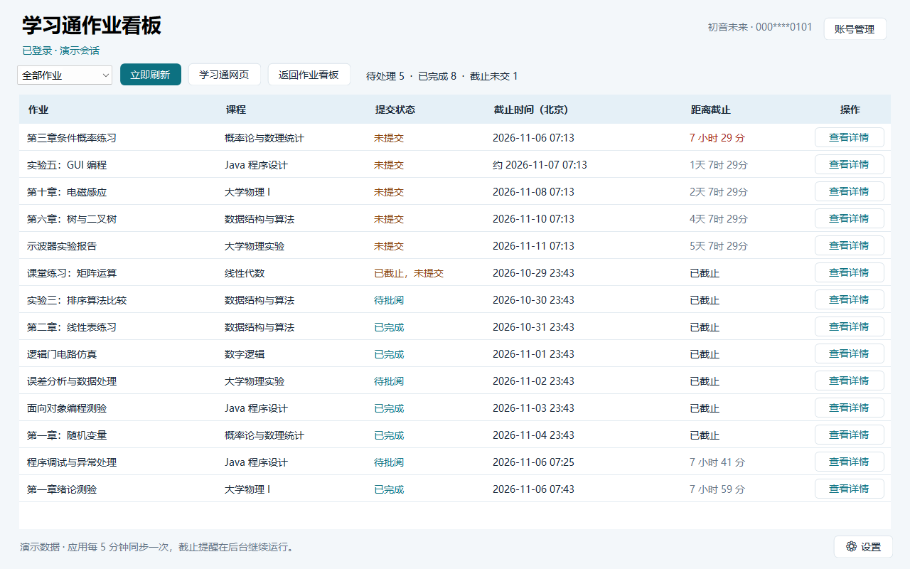
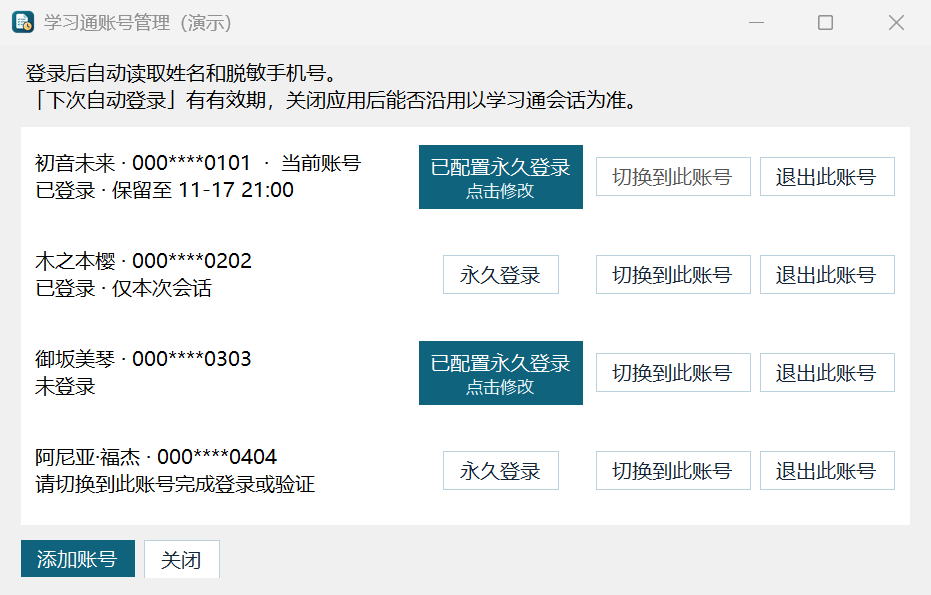
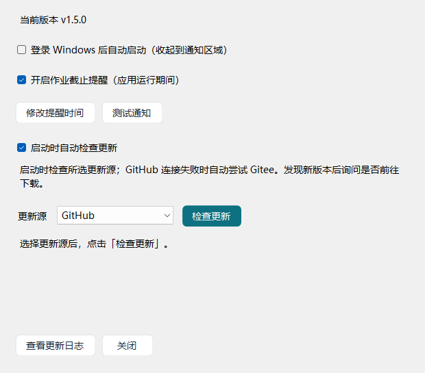

# chaoxingTasksPanel · 学习通作业看板

[English](README.md) | **简体中文**

一个用来汇总超星学习通作业的 Windows 桌面应用。打开看板即可查看各门课的作业、提交状态和截止倒计时，也能直接打开作业详情、下载附件和切换账号。

`Windows x64` · `C# / .NET 10` · `WinForms / WebView2` · `v1.5.0`

## 界面截图

以下界面为离线渲染，作业和账号均为虚构数据。应用界面为简体中文。

### 作业看板



### 账号管理



### 设置



## 功能

| 功能         | 说明                                                                                                                                                 |
| ------------ | ---------------------------------------------------------------------------------------------------------------------------------------------------- |
| 作业看板     | 显示作业、课程、提交状态、北京时间截止时间和剩余时间。                                                                                               |
| 筛选与排序   | 筛选待处理或已完成的作业。点击「提交状态」「截止时间」或「距离截止」切换排序方向，截止未交的作业单独标记，点击「作业」恢复默认顺序。                 |
| 自动刷新     | 看板每 5 分钟同步一次，也可以点击「立即刷新」。                                                                                                      |
| 详情与附件   | 点击「查看详情」独立打开每个作业，可通过 Alt+Tab 或任务栏预览切换。下载附件时可以选择文件名和保存位置。1.5.0 的作业详情及附件预览窗口加宽 100 像素。 |
| 多账号管理   | 自动显示姓名和脱敏手机号，各账号的登录会话独立保存。支持添加、切换和退出账号。                                                                       |
| 登录状态     | 启动时检查会话状态，显示是否已登录、会话是否仅限本次以及可确认的保留期限。可为单个账号启用永久登录，在会话失效时尝试自动重登。                       |
| 截止提醒     | 在截止前及截止时发送 Windows 通知；可在设置中修改提醒时间，也可点击「测试通知」立即测试。提醒记录保存在本机，避免重启后重复提醒。                    |
| 托盘与自启动 | 关闭或最小化主窗口后继续同步和提醒。双击托盘图标恢复窗口，右键菜单确认退出。可设置登录 Windows 后自动启动并收起到通知区域。                          |
| 更新与日志   | 查看并复制内置更新日志；启动时默认检查更新，可在设置中关闭。支持 GitHub、Gitee 更新源，GitHub 失败后自动尝试 Gitee，发现新版本后询问是否前往下载。   |
| 安装与升级   | 现代化中文 MSI 向导支持自定义路径、直接升级、修复和卸载；升级沿用原安装位置并保留用户数据。便携版不创建桌面和开始菜单快捷方式。                      |

## 开始使用

需要 **Windows 10 22H2（内部版本 19045）或更新的 64 位 Windows，包含 Windows 11**，以及 **Microsoft Edge WebView2 运行时**。发布的 EXE 已包含 .NET 运行时。安装和启动时均会检测，不满足 Windows 版本要求时提示并退出。

1. 从 [Releases 附件](https://github.com/Coolliangyuu/chaoxingTasksPanel/releases/latest)下载 **MSI 安装版**或**便携版 EXE**。安装包约 **49.41 MB**，便携版约 **52.25 MB**。
2. 使用 MSI 安装，或直接运行便携版。首次启动先询问是否开机自启动，之后再检查更新。
3. 在应用内的超星官方页面登录。需要使用其他账号时，在右上角选择「账号管理」→「添加账号」。
4. 登录后，使用筛选器和可排序的表头查找作业。点击一行右侧的「查看详情」即可打开作业原页。

### 登录保留与自动重登

登录时勾选超星官方的「下次自动登录」，应用会优先沿用该会话，保留期限由学习通决定。

在账号管理中，也可以通过「永久登录」为单个账号启用自动重登。应用检测到会话失效时，会在超星官方页面尝试重新登录。遇到短信验证码、滑块或其他验证时，由用户在页面上完成。

### 后台运行与作业提醒

提醒需要保持软件运行。关闭主窗口只会隐藏到托盘；要完全退出，请右键托盘图标，选择「退出面板」，并在确认窗口选择「是」。

默认提前 **48、24、12、6、3、1.5、1 小时**及 **30、15、10、5、3、2、1 分钟**提醒，并在截止时提醒一次。可在「设置 → 修改提醒时间」中调整。软件运行期间每 15 秒检查提醒；点击「测试通知」会发送独立测试，不改变真实作业的提醒记录。Windows 的通知权限和勿扰模式可能影响横幅显示。

### 升级与卸载

先从托盘退出程序，再直接运行新版 MSI。支持升级的新安装包会替换旧程序，沿用已保存的安装位置，保留账号、登录会话、提醒设置和自启动选择，无需先手动卸载。再次打开同一份 MSI 可修复或卸载。便携版退出后替换 EXE 即可。

从 Windows 设置或 MSI 卸载时会询问是否删除用户数据。默认「否」保留；选择「是」会在卸载成功后清理当前 Windows 用户的本软件数据；「取消」停止卸载。已安装旧修订的用户需要先升级到本安装包，新卸载选项才会生效。升级本身跳过数据清理。安装版与便携版共用账号数据，选择删除也会清理这份共享数据；另存到其他位置的附件和其他 Windows 用户的数据不在清理范围内。

## 从源码构建

在 Windows 安装 **.NET 10 SDK**、**Python 3**、**Microsoft Edge WebView2 运行时**，以及提供 `g++.exe` 和 `windres.exe` 的 **MinGW-w64** 工具链，并将工具加入 `PATH`。

在仓库根目录执行以下命令，以开发方式启动应用：

```powershell
dotnet run --project StudyTasks/StudyTasks.csproj
```

构建包含原生系统预检的正式 EXE 和 MSI：

```powershell
./build.ps1 -OutputDirectory ./dist
```

生成文件为 `dist/chaoxingTaskPanel.exe` 和 `dist/chaoxingTaskPanel-installer.msi`。发布时可将便携版附件命名为 `chaoxingTaskPanel-portable.exe`，两种版本使用相同的程序本体。构建调用 Windows 自带的 `makecab` 与 Windows Installer COM 接口，无需外置安装引导程序；EXE 和 MSI 各自均限制在 100 MB 以内。

重新生成包含虚构数据的三张离线演示图：

```powershell
dotnet run --project verification/FeatureChecks.csproj -c Release -- --demo-screenshots screenshots
```

此渲染工具不显示应用窗口、不初始化浏览器、不连接学习通、不发送通知，也不保存账号或自启动设置。

## 本机数据

- 浏览器会话保存在 `%LOCALAPPDATA%\ChaoxingStudyTasks\Browser`。
- 同目录的 `accounts.json` 保存账号列表，包括显示姓名、脱敏手机号、账号资料标识和当前账号。
- `settings.json` 保存应用设置，`reminder-history.json` 保存提醒记录，`update-source.txt` 保存所选更新源。
- 启用永久登录后，账号密码保存在当前 Windows 用户的凭据管理器中。关闭永久登录或退出对应账号时，应用会清除该账号保存的凭据。
- 启动与通知诊断日志也保存在此目录，并限制文件大小。保留数据时重装软件不会恢复默认状态。

兼容策略、启动排查、首次运行重置、卸载清理边界及验证范围见[开发与验证说明](docs/DEVELOPMENT.zh-CN.md)。UAC 实际前台表现，以及真实凭据、通知记录的删除仍需人工端到端验收；自动测试未删除现有用户数据。

## 仓库结构

```text
chaoxingTasksPanel/
├── README.md                  # 英文说明
├── README.zh-CN.md            # 简体中文说明
├── screenshots/              # 1.5.0 虚构数据的离线界面预览
├── StudyTasks/                # 应用源码、网页脚本、通知脚本和图标
├── Common/                    # 共用兼容策略与原生启动预检
├── InstallerUI/               # 原生 MSI 界面与卸载清理
├── verification/              # 功能、安装器验证与演示图工具
├── docs/                      # 开发与验证说明
├── build.ps1                  # 正式 EXE 与 MSI 构建入口
├── build-installer.ps1        # MSI 打包脚本
├── compatibility-policy.json # 支持的 Windows 版本策略
└── version-history.txt       # 构建时内置到应用的更新日志
```

## 版本记录

查看从首次发布到当前版本的[完整版本日志](version-history.txt)。也可在软件中打开「设置 → 查看更新日志」。
